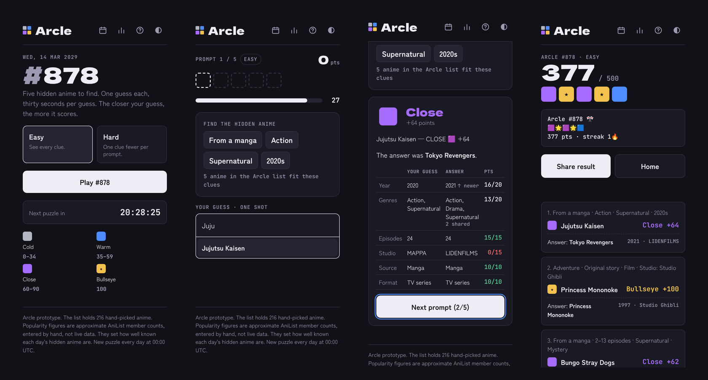
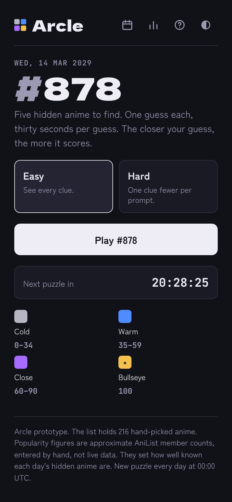
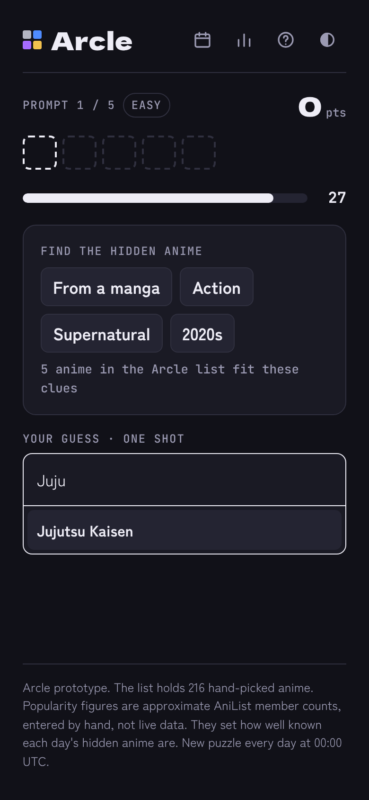
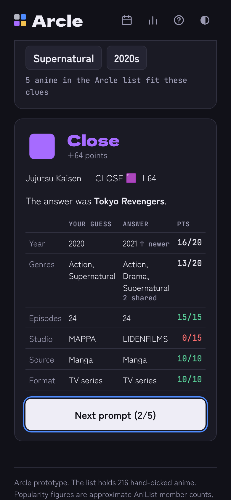
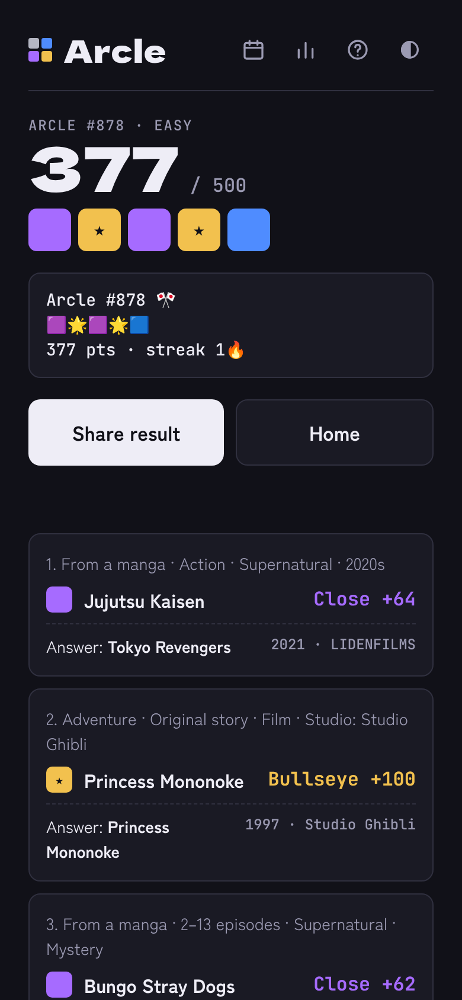
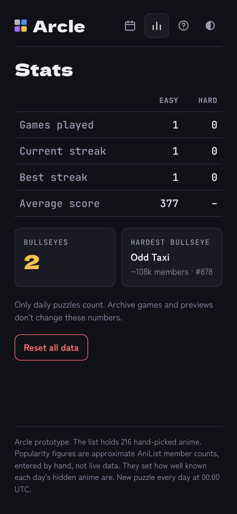
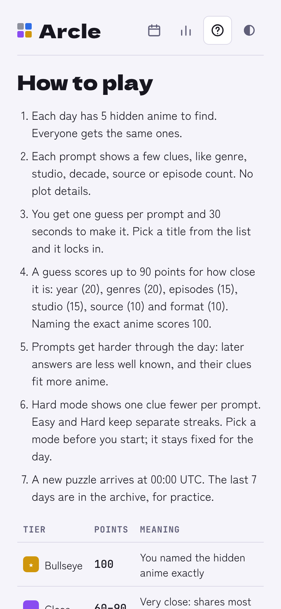

# Arcle



**A daily guessing game for anime fans.** Every day there are 5 hidden anime to find. Each one comes with a few clues. You get one guess and 30 seconds per prompt, and the closer your guess is, the more points you get.

**Play:** `https://m-k4sh1f.github.io/arcle/`

---

## How to play

1. Pick a mode: **Easy** shows every clue, **Hard** shows one clue fewer.
2. Each prompt shows 3–4 clues about a hidden anime, such as genre, decade, studio, source or episode count.
3. Type a title and pick it from the list. Short names like `JJK`, `AOT` and `FMAB` work, and so do romaji titles.
4. Your guess locks in right away. You only get one per prompt.
5. The answer is revealed with a side-by-side table that shows where your guess was close and where it wasn't.
6. After 5 prompts, share your result without spoiling anything.

Everyone gets the same puzzle each day. A new one starts at **00:00 UTC**.

## Scoring

Naming the exact anime scores **100**. Any other guess scores up to **90**, based on how close it is:

| Detail | Max points | How it's scored |
|---|---|---|
| Year | 20 | Minus 4 points per year apart |
| Genres | 20 | Shared genres ÷ all genres between the two |
| Episodes | 15 | Closer episode counts score more. Films only match films. |
| Studio | 15 | Full points if they share a studio |
| Source | 10 | Manga, light novel, original, and so on |
| Format | 10 | TV series, film, OVA or ONA |

Each prompt gets a tier:

| Tile | Tier | Points |
|---|---|---|
| 🌟 | Bullseye | 100 (exact answer) |
| 🟪 | Close | 60–90 |
| 🟦 | Warm | 35–59 |
| ⬜ | Cold | 0–34 |
| ⬛ | Miss | 0 (no guess in time) |

The max daily score is **500**.

## Share text

The Share button copies a spoiler-free summary:

```
Arcle #878 🎌
🟪🌟🟪🌟🟦
377 pts · streak 1🔥
```

Hard mode adds `Hard` to the first line. Anime titles never appear in the share text.

## Screenshots

| Home | Guessing | Answer reveal |
|---|---|---|
|  |  |  |

| Results | Stats | How to play (light mode) |
|---|---|---|
|  |  |  |

## Features

- **Daily puzzle**: the same 5 prompts for everyone, picked from the date
- **Easy and Hard modes**, each with its own streak
- **30-second timer** per prompt that keeps running if you reload the page
- **Autocomplete** that matches English titles, romaji titles and short names
- **Stats**: games played, current and best streaks, average score, bullseyes, and your hardest bullseye
- **Archive**: replay the last 7 days for practice (doesn't affect stats)
- **Dark mode** by default, with a light mode toggle
- **Works on phones**, with no account and no server. Progress saves in your browser.

## How the daily puzzle works

There is no server and no database. The puzzle comes from the date:

1. The date (for example `2026-10-19`) seeds a random number generator, so every player gets the same picks.
2. For each of the 5 slots, the game picks a hidden anime from a popularity range and then picks clues for it.
3. A clue set is only used if it narrows the list to the right number of anime for that slot.

| Prompt | Hidden anime comes from | Clues (Easy) | Anime that fit the clues |
|---|---|---|---|
| 1 | Top 65 most popular | 4 | 2–5 |
| 2 | Ranks 15–100 | 4 | 3–7 |
| 3 | Ranks 20–130 | 4 | 4–8 |
| 4 | Ranks 40–170 | 3 | 5–11 |
| 5 | Ranks 70 and below | 3 | 6–14 |

Prompts get harder through the day. No hidden anime repeats within 30 days. `validate.js` checks all of these rules, and the current list passes for 1,000 days in a row.

## Project files

| File | What it is |
|---|---|
| `index.html` | The built game. This is the file GitHub Pages serves. |
| `data.js` | The anime list, one row per anime |
| `engine.js` | Daily puzzle generator, clues and scoring |
| `app.js` | Screens, timer, autocomplete and saving |
| `template.html` | Page layout and styles |
| `build.py` | Joins the files above into `index.html` |
| `validate.js` | Checks that upcoming puzzles follow every rule |
| `screenshots/` | Images used in this README |
| `CNAME` | Your custom domain, if you set one up (GitHub creates it) |

## Run it on your computer

Open `index.html` in any browser. That's it.

To test a future day's puzzle, add `?date=` to the address:

```
index.html?date=2026-11-05
```

Test dates count toward stats like a normal day, so use **Stats → Reset all data** when you're done.

## Making a change

You'll need [Python 3](https://www.python.org/) and [Node.js](https://nodejs.org/).

1. Edit `data.js`, `engine.js`, `app.js` or `template.html`.
2. Rebuild the game:
   ```bash
   python3 build.py
   ```
3. Check the next year of puzzles:
   ```bash
   node validate.js 365
   ```
   It should end with `All 365 days pass every rule.`
4. Open `index.html` and test a few dates.
5. Upload the changed files plus the new `index.html` to GitHub and commit.

### Rules for `data.js`

- **Add new anime only at the bottom.** Never reorder or delete rows. An anime's id is its row number, and saved games store ids.
- **Changing `data.js` or `engine.js` changes every day's puzzle**, including past days and today's. Push those changes right after 00:00 UTC.
- Use only spoiler-free facts: titles, year, season, format, source, studios, genres and episode count.

Each row looks like this:

```js
["Ping Pong the Animation", "Ping Pong the Animation", "Ping Pong", 2014, "Sp", "TV", "M", "Tatsunoko Production", "Drama|Psychological|Sports", 11, 200],
// english, romaji, short names, year, season, format, source, studios, genres, episodes, popularity (thousands)
```

## Deploying with GitHub Pages

1. Upload all files to a **public** repository.
2. Go to **Settings → Pages**, set **Source** to **Deploy from a branch**, then pick `main` and `/ (root)`.
3. The game goes live at `https://YOUR-USERNAME.github.io/arcle/` within a couple of minutes.

To use your own domain, enter it under **Settings → Pages → Custom domain** and follow [GitHub's custom domain guide](https://docs.github.com/en/pages/configuring-a-custom-domain-for-your-github-pages-site/managing-a-custom-domain-for-your-github-pages-site). Keep the `CNAME` file in the repo when you upload updates.

## Plans

- Freeze past puzzles so updating the anime list doesn't change days that already happened
- Grow the anime list past 216 titles
- Refresh popularity numbers every few months

## Notes

- The list holds **216 hand-picked anime**, from *Astro Boy* (1963) to *Dandadan* (2024).
- Popularity numbers are **rough estimates** of AniList member counts, entered by hand. They only decide how well known each day's hidden anime is.
- Arcle is a fan project. It isn't connected to AniList or any studio.
